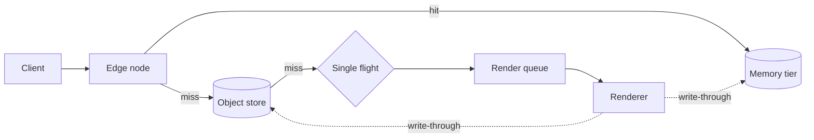
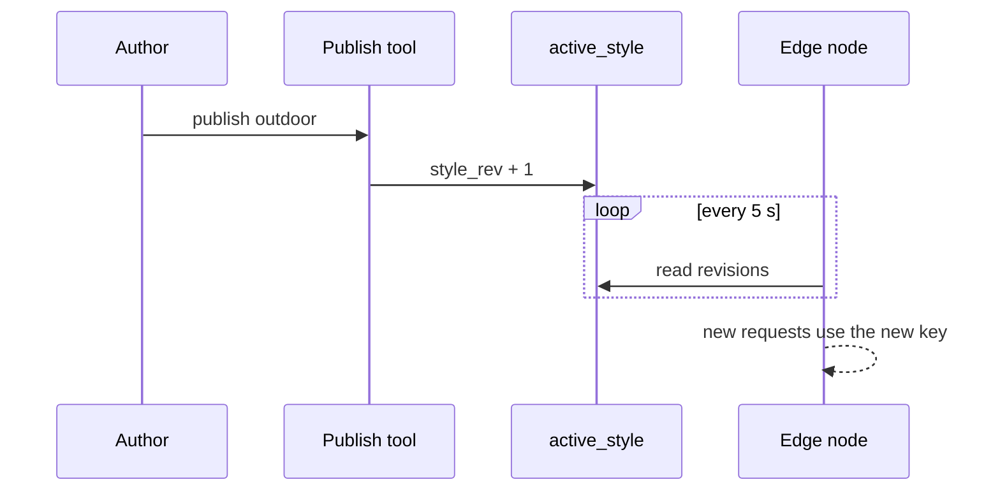
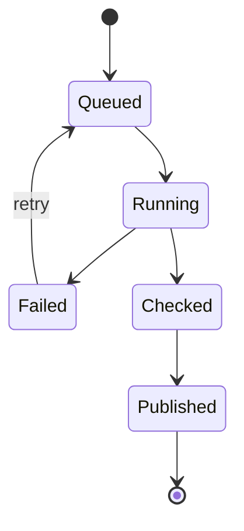

# How a tile gets its coordinates

A reference for anyone who has to reason about tile numbers by hand, which sooner or later is
everyone. Fernway uses the same scheme as most web maps, Web Mercator, with the origin at the
top-left corner.

## From latitude and longitude to a tile

At zoom level $z$ the world is $2^z \times 2^z$ tiles. For a longitude $\lambda$ and a latitude
$\varphi$, both in radians, the fractional tile position is:

$$
x = 2^z \cdot \frac{\lambda + \pi}{2\pi}
\qquad
y = 2^z \cdot \frac{\pi - \ln\left(\tan\varphi + \sec\varphi\right)}{2\pi}
$$

Take the floor of each to get the tile, and keep the fraction if you need the pixel inside it. A
tile covers $256$ logical pixels, so the ground resolution at latitude $\varphi$ is:

$$
r(z, \varphi) = \frac{C \cos\varphi}{256 \cdot 2^{z}}, \quad C \approx 40\,075\,016.686\ \text{m}
$$

At $z = 15$ near Gothenburg ($\varphi \approx 57.7°$) this gives $r \approx 2.55$ m per pixel, which
is why a footbridge starts to appear at about that zoom.

```math
\sum_{z=0}^{18} 4^{z} = \frac{4^{19} - 1}{3} \approx 9.2 \times 10^{10}
```

That sum is the number of tiles in the world to $z = 18$, and it is the reason nobody pre-renders
everything. A price in dollars such as $5 or $10 must not turn into maths, and neither must this
escaped one: \$x.

## Contours

The spacing between contours is a choice, and it follows the zoom:

| Zoom | Interval $\Delta h$ | Index every |
|---:|---:|---:|
| 11 | 100 m | 500 m |
| 13 | 25 m | 100 m |
| 15 | 10 m | 50 m |

A slope in percent is $100 \cdot \frac{\Delta h}{\Delta d}$, and a trail rated "steep" is above
$\approx 15\%$.

## Worked examples

The Skåne coast at $z = 15$: for $\lambda = 14.25°$ and $\varphi = 55.65°$ we get

$$
x = 2^{15} \cdot \frac{14.25 + 180}{360} = 17\,681.07
\qquad
y \approx 10\,187.42
$$

so the tile is $(17681, 10187)$, and the point sits about $0.07 \times 256 \approx 18$ pixels from its
west edge.

A matrix for the rotation the print pipeline applies to a north-up map:

$$
\begin{pmatrix} x' \\ y' \end{pmatrix}
=
\begin{pmatrix} \cos\theta & -\sin\theta \\ \sin\theta & \cos\theta \end{pmatrix}
\begin{pmatrix} x \\ y \end{pmatrix}
$$

And the haversine distance, which every new starter writes wrongly once:

```math
d = 2R \arcsin\sqrt{\sin^2\frac{\Delta\varphi}{2} + \cos\varphi_1 \cos\varphi_2 \sin^2\frac{\Delta\lambda}{2}}
```

Inline in a list, in a table and in a heading-free quote:

- a tile's width in degrees is $360 / 2^z$
- a band of $n$ zooms multiplies storage by about $\frac{4^n - 1}{3}$

> The world at $z = 0$ is one tile, and everything after that is arithmetic.

## The request path

The cache's tiers, as the [RFC](rfc-tile-cache.md) describes them:



What a publish does, step by step:



A data build's states:



## Raw HTML that authors really use

A callout that the writer built by hand, because Markdown has no such thing:

<div class="callout" style="border-left: 4px solid #2a7">
  <p><strong>Rule of thumb:</strong> every zoom level doubles the tile count in each direction.</p>
</div>

A definition with keyboard keys and a sub and superscript: press <kbd>Shift</kbd> + <kbd>Z</kbd> to
zoom out, H<sub>2</sub>O is water and 10<sup>3</sup> is a kilometre's worth of metres.

<details>
<summary>Why not TMS numbering?</summary>

TMS counts $y$ from the bottom, so its $y$ is $2^z - 1 - y$ of ours. Every few months someone
reports that the map is upside down, and this is why.

</details>

<table>
  <caption>Zoom bands in the cost model</caption>
  <thead><tr><th>Band</th><th>Tier</th></tr></thead>
  <tbody>
    <tr><td>z0 to z10</td><td>memory</td></tr>
    <tr><td>z11 and above</td><td>object store</td></tr>
  </tbody>
</table>

And some that must not run, whatever the page does with the rest of it:

<script>document.title = "this must never execute";</script>


<a href="javascript:alert(1)">a link that goes nowhere</a>

<!-- A comment a reader should never see. -->
