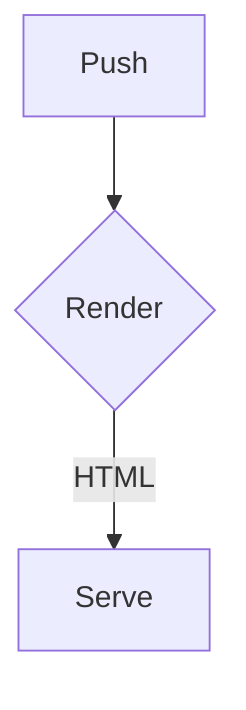

# Code

Inline `code`, ``double `backtick` code``, and `<script>` in a code span.

```rust
fn main() {
    println!("<hello> & {}", 1 < 2);
}
```

```js title="x.js" {1,2}
console.log("info string with attrs");
```

~~~python
print("tilde fence")
~~~

```
no language
```

    indented code block
    second line



```math
\int_0^1 x^2 \, dx = \frac{1}{3}
```

````md
```
nested fence
```
````

Unclosed fence at the end:

```text
still code
