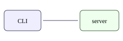

# API notes (plan)

Endpoints the CLI calls, one per verb. The flow between them:

- `GET /api/v1/docs/{id}` — head, hashes, counts
- `POST /api/v1/docs/{id}/threads` — a new Thread on head
- `GET /api/v1/events?since=SEQ&wait=30` — the long-poll `wait` uses
